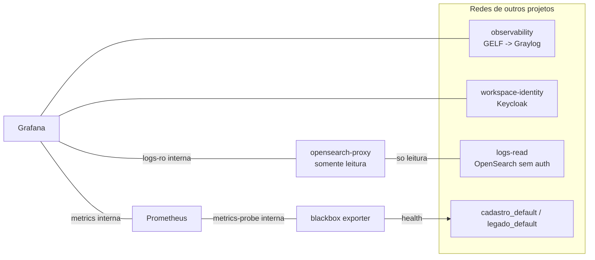

# Grafana — dashboards e alertas do Workspace

Grafana OSS 13.3.1 em Docker, com login único pelo Keycloak e dashboards/alertas **como código**, lendo os logs que os
projetos já enviam ao [Graylog](../graylog). Decisões: [ADR-0001](docs/adr/0001-stack-grafana-oss.md) e
[ADR-0002](docs/adr/0002-sso-keycloak-grafana.md). Especificação: [docs/specs/001-implantacao-grafana](docs/specs/001-implantacao-grafana/spec.md).

> Estado: T01-T15, T17, T20, T22 e T23 entregues e T16 (fechamento) concluída; ADRs 0001-0004 **aceitos** pelo responsável técnico em 2026-11-17 (T21, scrape de Keycloak/SonarQube, segue fora da v1).
> **OpenSearch somente leitura (T23, ADR-0004)**: o Grafana lê o OpenSearch só pelo `opensearch-proxy` (nginx + njs, allowlist estrita). Escrita e leitura fora do index pattern ficam negadas ao Viewer; sobram riscos residuais medidos (seção do datasource e ADR-0004).

## Pré-requisitos

- Docker Desktop com Compose v2 (cerca de 300 MB de RAM para o Grafana; suba **um stack pesado por vez**) e Git Bash/WSL (os scripts são `bash`).
- Redes externas `observability` e `workspace-identity` (criadas pelos projetos graylog e keycloak), `metrics` (criada por `prometheus/docker-compose.metrics.yml`; suba-o antes) e `logs-read`
  (criada pelo graylog, T03; agora só o OpenSearch e o `opensearch-proxy` entram nela, o Grafana não). Para o uso completo, Graylog e Keycloak provisionados.
- `jq` e `shellcheck` são opcionais (os lints usam imagens Docker pinadas se faltarem).

## Ordem de subida

1. **Redes**: criadas pelos projetos que as donam (`observability` e `logs-read` pelo [graylog](../graylog); `workspace-identity` pelo
   [keycloak](../keycloak); `metrics`/`metrics-probe` por `prometheus/docker-compose.metrics.yml`; `logs-ro` pelo compose deste projeto).
2. **Graylog** (`../graylog`, com o provisioner) para logs, datasource e alertas de log.
3. **Keycloak** (`../keycloak`, `generate-env.sh` e provisioner) para o login único; gera o `KC_GRAFANA_CLIENT_SECRET`.
4. **Grafana** (`./scripts/generate-env.sh` e `docker compose up -d --build`; com o Graylog de pé, junto do `-f docker-compose.graylog.yml`).
5. **Métricas** (`docker compose -f prometheus/docker-compose.metrics.yml up -d`, com `cadastro` e `legado` de pé) **antes** do Grafana, pois ele entra na rede `metrics`.

**Keycloak e Graylog não rodam juntos** (memória e falha intermitente documentada): nos testes, uma passagem com Keycloak + Grafana
(`smoke-test.sh --skip-datasource --skip-alerts --skip-metrics`, `e2e.sh`) e outra com Graylog + Grafana (`--skip-sso`, `smoke-proxy.sh`,
`smoke-graylog.sh`). Uso diário: suba o que precisa; sem o Graylog não há dados nos dashboards, sem o Keycloak só o break-glass entra.

## Arquitetura de redes



| Rede | Quem entra | Para quê |
|---|---|---|
| `observability` | Grafana, Graylog | logs do Grafana por GELF (e, como efeito, rota às APIs que também estão nela) |
| `workspace-identity` | Grafana, Keycloak | SSO (token/userinfo por `keycloak:8080`) |
| `logs-ro` (`internal`) | Grafana, `opensearch-proxy` (alias `opensearch-ro`) | único caminho do Grafana ao OpenSearch |
| `logs-read` | OpenSearch, `opensearch-proxy` | leitura do OpenSearch; o Grafana **não** entra |
| `metrics` (`internal`) | Prometheus, Grafana | datasource `prometheus` |
| `metrics-probe` (`internal`) | Prometheus, blackbox | sondas de health; o Grafana não alcança o blackbox |

## Como subir

```bash
./scripts/generate-env.sh      # cria o .env com segredos aleatórios (nunca versionado)
docker compose up -d --build   # imagem local: grafana/grafana 13.3.1 (tag + digest) + plugin do OpenSearch
```

A imagem base é `grafana/grafana` (o `grafana/grafana-oss` do Docker Hub parou na 13.0.2). Toda a configuração está em
variáveis `GF_*` do `docker-compose.yml` (sem anônimo, sem sign-up, sem telemetria, logs JSON, pt-BR); os plugins do
catálogo e os pré-instalados da grafana.com estão desligados (só o plugin do build).

## Dashboards como código

`provisioning/dashboards/<projeto>/*.json` é lido pelo provider `providers.yaml` (uma pasta no Grafana por subpasta;
`allowUiUpdates: false`, sem exclusão pela UI). Para persistir uma edição feita na UI, exporte o JSON e abra PR.
Regras (verificadas por `scripts/lint-dashboards.sh`): `uid` único em kebab-case, sem `id`, `schemaVersion` >= 39,
`editable: false`, datasource só por uid provisionado, título `<Sistema> - <Assunto>` em PT-BR, **sem painel `logs`** e
sem campos pessoais nas consultas dos dashboards. Atenção: isto vale para os dashboards, não é uma barreira técnica; o `opensearch-proxy` (T23) bloqueia escrita e leitura fora do index pattern, mas o Viewer ainda lê documentos brutos dos index sets do pattern (ver "Proxy somente leitura" abaixo e o ADR-0004).

- `legado/overview.json` (`legado-overview`, T11): volume por nível, erros, logins falhos (só contagem) e chamadas da API interna de migração por status, só agregações. **Campos a confirmar contra logs reais**: `service_name:legado-api`, `level` (<= 3 = erro) e `level_name` (pipeline do Graylog), `message` ("Sign-in failed", "Internal API signature rejected", texto dos templates Serilog), `RequestPath` (`/api/v1/internal/*`) e `StatusCode` (log de requisição do Serilog; se forem texto analisado, usar `.keyword`); séries sem `terms` aparecem como `Count`. Teste: `tests/dashboards/legado-overview.test.sh`.
- `keycloak/authentication.json` (`keycloak-authentication`, T12): logins com sucesso/falha, falhas em rajada e eventos por tipo/cliente/realm, só agregações. **Campos a confirmar contra logs reais** (auditoria `audit_schema=1` do Keycloak; a extração do JSON no Graylog ainda não foi confirmada): `service_name:keycloak`, `kind:user`, `type` (`LOGIN`, `LOGIN_ERROR`; `LEGACY_*` só aparece na tabela por tipo), `client_id`, `realm_id`; se `type` for texto analisado, usar `type.keyword`. Teste: `tests/dashboards/keycloak-authentication.test.sh`.
- `sonarqube/infra.json` (`sonarqube-infra`, T13): volume por nível e por serviço, erros, avisos e reinícios do SonarQube/PostgreSQL, só agregações. **Campos a confirmar contra logs reais**: `service_name` (`sonarqube`, `sonarqube-db`), `level` (numérico, ajustado pelo texto do log) e `level_name`, `message` ("SonarQube is operational" marca cada inicialização; reinício = mais de uma na janela). Teste: `tests/dashboards/sonarqube-infra.test.sh`.
- `graylog/platform.json` (`graylog-platform`, T13): volume e erros por serviço, taxa de erro por serviço (tabela) e **"Serviços sem log"** (um cartão por serviço esperado, janela fixa de 15 min; vermelho "Sem logs" = nenhum log). Serviços esperados: `cadastro-api`, `cadastro-web`, `legado-api`, `legado-web`, `keycloak-server`, `sonarqube`, `grafana` (migrators e bancos ficam de fora por logarem pouco); mudar a lista exige editar o JSON e o teste. Validação com stack real no smoke da etapa seguinte: parar um serviço (ex.: `docker stop cadastro-web`) e, após 15 min, ver o cartão virar "Sem logs". **A confirmar**: `service_name` como keyword (senão `.keyword`), e na tabela de taxa de erro os nomes de coluna `Count 1`/`Count 2` gerados pelo join dos dois `terms`. Teste: `tests/dashboards/graylog-platform.test.sh`. O health das APIs (T17) está em `graylog/api-health.json` (ver "Health das APIs no Grafana").

Acesse **http://localhost:3000** (somente `127.0.0.1`). O acesso normal é pelo Keycloak; a conta local
(`GRAFANA_ADMIN_USER`/`GRAFANA_ADMIN_PASSWORD` no `.env`) é só para recuperação se o Keycloak estiver fora do ar.

## Variáveis do `.env`

| Variável | Uso |
|---|---|
| `GRAFANA_ADMIN_USER` | usuário break-glass (nunca `admin`) |
| `GRAFANA_ADMIN_PASSWORD` | senha do break-glass |
| `GF_SECURITY_SECRET_KEY` | chave de cifra de segredos do Grafana; trocá-la invalida segredos salvos |
| `KC_GRAFANA_CLIENT_SECRET` | segredo do client `grafana` no Keycloak (copiado de `../keycloak/.env`; nunca exibido) |

A rotação de `GRAFANA_ADMIN_PASSWORD` é **manual**: o Grafana só aplica `GF_SECURITY_ADMIN_PASSWORD` no primeiro boot do
banco; depois de mudar o `.env`, redefina a senha na UI ou com `grafana cli admin reset-admin-password` dentro do container.

O `generate-env.sh` não sobrescreve um `.env` existente. No Linux/WSL o arquivo nasce com permissão `0600`; no Git
Bash/NTFS a permissão não é aplicável, e o arquivo continua fora do git.


## Login único (Keycloak)

Provider `auth.generic_oauth` por `GF_AUTH_GENERIC_OAUTH_*` no `docker-compose.yml` (ADR-0002): Authorization Code +
PKCE S256, client confidencial `grafana` do realm `workspace`. O navegador usa o host público
(`http://localhost:8180`); o Grafana fala com o Keycloak por `http://keycloak:8080` (rede `workspace-identity`), e o
issuer continua o público. O segredo `KC_GRAFANA_CLIENT_SECRET` nasce no `.env` do keycloak e o
`./scripts/generate-env.sh` o copia para o `.env` do grafana **sem exibi-lo** (se o `.env` já existe, só completa o que
falta). Suba o Keycloak antes e rode o `generate-env.sh` do keycloak primeiro.

O papel vem do claim `roles` por JMESPath (`role_attribute_path`, sintaxe da 13.x), sem papel padrão:
`contains(roles[*], 'admin') && 'Admin' || contains(roles[*], 'grafana-editor') && 'Editor' || contains(roles[*], 'grafana-viewer') && 'Viewer'`.
Com `role_attribute_strict=true`, quem não tem nenhuma dessas roles (inclusive o usuário final do Cadastro) é negado.
`allow_assign_grafana_admin=false`: ninguém vira Server Admin pelo SSO. O logout passa pelo `end_session` do Keycloak e
volta para `http://localhost:3000/login`. Roles novas valem no próximo login (`skip_org_role_sync=false`).

**Limites de sessão (ADR-0002)**: papel e revogação mudados no Keycloak só valem no próximo login do Grafana. Por isso a sessão
expira em **8 h de inatividade** (`GF_AUTH_LOGIN_MAXIMUM_INACTIVE_LIFETIME_DURATION`) e **12 h absolutas**
(`GF_AUTH_LOGIN_MAXIMUM_LIFETIME_DURATION`), em vez dos padrões do Grafana (7 dias e 30 dias). Ao reautenticar, o Grafana relê as
roles do Keycloak. Limite conhecido: sem `use_refresh_token` o Grafana não consulta o Keycloak durante a sessão; a janela de
exposição após uma revogação é de até 12 h (e, se o usuário ainda tiver sessão ativa no Keycloak, o novo login é silencioso
até essa sessão cair). Escolha deliberada por simplicidade: refresh token + `offline_access` não foi adotado.

## Perfis

| Role Keycloak | Role Grafana |
|---|---|
| `grafana-viewer` | Viewer |
| `grafana-editor` | Editor |
| `admin` | Admin da organização |
| (nenhuma) | login negado |

## Datasource de logs (Graylog/OpenSearch) — T07

`provisioning/datasources/graylog-opensearch.yaml` (uid `graylog-opensearch`, só leitura na UI, `isDefault`): plugin
`grafana-opensearch-datasource` 2.34.7 em `http://opensearch-ro:8080` (o `opensearch-proxy`, que encaminha a `opensearch:9200`), **sem credenciais** (o OpenSearch do
Graylog roda sem security plugin e só é alcançável pelo proxy, pela rede `logs-read`; em produção: security plugin + usuário somente leitura).

- **Spike (2026-11-17)**: compatível sem fallback. Grafana 13.3.1 + plugin 2.34.7 + OpenSearch 3.7.0 (o do compose do Graylog):
  `health` = "Index OK. Time field name OK." e agregações `terms` por `level`/`service_name` funcionam (`flavor: opensearch`,
  `version: "3.7.0"`, `timeField: timestamp`). Elasticsearch nativo/Infinity não foram necessários.
- **Index pattern** (`jsonData.database`): `cadastro_*,legado_*,keycloak_*,sonarqube_*,grafana_*,graylog_*`, o prefixo de cada
  index set do Graylog (`<prefixo>_<n>`). Todos são gravados **depois do pipeline de mascaramento LGPD** do Graylog
  (regras de `../graylog/provisioning/rules/templates/`; o do Grafana ainda descarta login/e-mail, regra 19/21), ou seja, o
  mascaramento já foi aplicado em todos. Ficam de fora `gl-events_*`, `gl-system-events_*` (internos do Graylog) e
  `top_queries-*`/`.plugins-*` (internos do OpenSearch). Index set novo no Graylog exige incluir o prefixo no YAML.
  `pplEnabled: false` (PPL aceitaria `source=<qualquer índice>`).
- **Proxy somente leitura (T23, ADR-0004)** — `opensearch-proxy/` (`nginx.conf` + `guard.js` em njs; imagem `nginx:1.29-alpine` por tag+digest,
  BSD-2-Clause; usuário 101, rootfs read-only, `cap_drop ALL`, `no-new-privileges`, sem porta no host). Redes: o proxy está em `logs-read`
  (OpenSearch) e em `logs-ro` (`internal`, só Grafana + proxy, alias `opensearch-ro`); o **Grafana não está mais na `logs-read`**.
  Allowlist: `GET /`, `POST [/<padrão>]/_msearch`, `GET /<padrão>/_mapping`, `GET|POST /<padrão>/_field_caps`; o resto (`PUT/DELETE/PATCH`, `_cat`,
  `_search`, `_bulk`...) = 403. O índice de cada cabeçalho do `_msearch` (e a URL) precisa casar os prefixos do pattern e as queries não podem
  referenciar outro índice (`index`, `_index`, `indexed_shape`, `wrapper`). Os 4 riscos do ADR-0001 (Viewer lê `gl-events_0` pelo `index` no corpo, lista o
  OpenSearch, faz `PUT` e `DELETE`) viraram **asserções** na parte 3 do `smoke-test.sh` e em `scripts/smoke-proxy.sh` (hardening + allowlist).
  **Residual medido (ADR-0004)**: a validação do corpo é heurística; o Viewer ainda lê qualquer documento dos index sets do pattern; quem entrar na
  `logs-read` fala com o OpenSearch sem autenticação. Index set novo no Graylog: atualizar `database` do datasource **e** `PREFIXES` do `guard.js`
  (o `lint-repo.sh` confere a igualdade). Se o proxy cair, o Grafana não lê logs e as regras de alerta de log entram em erro de avaliação.
- Fixtures GELF sintéticas (sem dado pessoal) em `tests/fixtures/gelf/`, com `__RUN_ID__` trocado por execução e enviadas por
  GELF HTTP (`127.0.0.1:12202`); caem nos index sets `cadastro_*`/`legado_*` pelo `service_name`.

## Logs do Grafana no Graylog — T08

```bash
# Graylog de pé (Keycloak derrubado: não rodam juntos). O override troca o driver de log para GELF (tag grafana):
docker compose -f docker-compose.yml -f docker-compose.graylog.yml up -d --build
./scripts/smoke-graylog.sh   # logins falhos e 404 autenticado do break-glass -> service_name:grafana, nível, sem login/e-mail em claro (no Grafana 13.3.1 login falho é log info "Request Completed", não warn)
```

O compose sem o override recria o container com o driver padrão e os logs deixam de ir ao Graylog: suba sempre com os dois
arquivos quando o Graylog estiver de pé. `./scripts/smoke-test.sh` não recria o container (o `smoke-graylog.sh` prova isso).
No Graylog o stream é `Grafana - Infra`; a regra `19-grafana-json` guarda só `level`, `logger` e `msg`.

## Backup e restauração — T09

O estado do Grafana (usuários SSO, preferências, silences, anotações; SQLite) fica no volume `grafana_grafana-data`.
O plugin do OpenSearch **não** está no volume (vem da imagem) e dashboards/alertas vêm do repositório: só o volume precisa de backup.

```bash
./scripts/backup.sh                                              # gera .backups/grafana-data-<UTC>.tar.gz (0600)
./scripts/restore.sh --yes .backups/grafana-data-<UTC>.tar.gz    # DESTRUTIVO: substitui o conteúdo do volume
```

- **Consistência**: o `backup.sh` para o Grafana por alguns segundos, copia o volume (somente leitura, por um contêiner
  `alpine` pinado) e reinicia o Grafana se ele estava rodando. Foi preferido ao `sqlite3 .backup` porque a imagem não
  traz o `sqlite3` e a parada dá um instantâneo coerente do banco (WAL incluído) e dos demais arquivos.
- **Frequência**: diária (agendador do SO, ex.: Agendador de Tarefas/cron chamando `./scripts/backup.sh`) e sempre antes de
  atualizar a versão do Grafana. **Retenção: 30 dias**, igual à do Graylog; o próprio `backup.sh` apaga os arquivos
  `grafana-data-*.tar.gz` mais antigos que isso (rotação a cada execução).
- **Segurança**: o arquivo contém contas e preferências (dado pessoal de operadores), por isso `0600` em `.backups/`
  (diretório `0700`, fora do git) e nunca é copiado para fora da máquina sem criptografia. Não contém o `.env`. No NTFS
  (Git Bash) a permissão não é aplicável; use Linux/WSL em produção.
- **Restore**: exige `--yes`; antes de apagar valida o arquivo (gzip íntegro, sem caminhos absolutos ou `..`, só arquivos e
  diretórios: symlink, hardlink e dispositivos são recusados; com `grafana.db`); faz **backup automático do estado atual**
  (`.backups/`) antes de trocar nada; extrai para um volume temporário e só então substitui o conteúdo (falha na extração
  não toca o volume; falha na troca devolve o backup de segurança); roda os auxiliares sem rede (`--network none`); toca só
  no volume `grafana_grafana-data`; funciona em volume vazio ou inexistente (ex.: após `docker compose down -v`) e reinicia o
  Grafana se ele estava rodando, também em caso de falha (senão, `docker compose up -d`). O `backup.sh` confere gzip/tar/`grafana.db`
  do arquivo gerado e remove `.partial` órfãos na rotação.
- Teste: `./scripts/smoke-backup.sh` (usuário e preferência de teste, backup, recusas, symlink/hardlink, falha no meio, `down -v`, restore e
  conferência; recria o container com o override GELF se ele estava ativo e apaga os backups da rodada, menos o de segurança inicial).

## Métricas e health check das APIs (Prometheus + blackbox)

Projeto compose próprio em [prometheus/](prometheus/) ([ADR-0003](docs/adr/0003-prometheus-blackbox-health.md)):
Prometheus 3.16.0 e blackbox exporter 0.29.1 (tag + digest), retenção de 30 dias, **sem porta no host**, usuário
não-root. O blackbox sonda `/health/live` e `/health/ready` de `cadastro` e `legado` (alvos em
`prometheus/targets/apis.yml`, rótulos `project`/`endpoint`); `WebAPI` não expõe health e fica de fora.

```bash
# cadastro e legado de pé (criam as redes cadastro_default/legado_default)
docker compose -f prometheus/docker-compose.metrics.yml up -d
./scripts/smoke-metrics.sh        # config (promtool), hardening, alvos up, probe_success 1 -> 0 -> 1 e diagnóstico de DNS (instância descartável)
# consulta ad hoc (sem porta publicada):
docker exec grafana-metrics-prometheus-1 wget -qO- 'http://127.0.0.1:9090/api/v1/query?query=probe_success'
```

Só o blackbox entra nas redes das APIs; Prometheus e Grafana (T17) ficam na rede `metrics`, sem rota até as APIs.
Disponibilidade gravada em `project_endpoint:probe_success:avg_over_time{5m,24h,7d,30d}`. Mudanças em `prometheus.yml`
e `rules.yml` exigem `restart` (lifecycle API desligada); `targets/` recarrega sozinho. Alvo novo: edite `targets/apis.yml`.

**Risco conhecido (alvos por nome de container)**: os alvos usam os aliases `cadastro-api`/`legado-api` (o alias `api` é ambíguo entre as
duas redes; os nomes de container `cadastro-api-1`/`legado-api-1` mudam com projeto/escala). Para isso os composes de `cadastro` e `legado` ganharam
esse alias na rede default (mudança aditiva, ADR-0003). Se o alias sumir (compose antigo, serviço renomeado), o nome deixa de resolver e `probe_success` vira 0, igual a "API fora do ar".
A mitigação é diagnóstico: o blackbox zera `probe_ip_addr_hash` (medido: `0`; resolvido = hash > 0) quando o DNS não resolve (e `probe_dns_lookup_time_seconds` acompanha a resolução),
então o alerta da T17 deve separar "`probe_ip_addr_hash` = 0" (nome/DNS) de "hash > 0 e `probe_success` 0" (API fora).
O `smoke-metrics.sh` prova essa distinção. O smoke usa uma instância descartável do Prometheus (as séries reais não recebem alvos falsos).
Prometheus e blackbox ainda **não** enviam logs ao Graylog (decisão consciente, ADR-0003; avaliar depois).

## Alertas como código (T14)

`provisioning/alerting/{rules,contact-points,policies}.yaml` (arquivos nativos do Grafana; regras vêm com `provenance: file`, sem
edição pela UI). Uma pasta por projeto (mesmos nomes das pastas dos dashboards: `cadastro`, `legado`, `keycloak`, `graylog`),
grupos de avaliação por assunto e labels `project`/`severity` em toda regra.

| Regra (pasta) | Condição | Relação com o Graylog |
|---|---|---|
| Cadastro - Taxa de erros alta (`cadastro`) | erros (`level <= 3`) / total de `service_name:cadastro-*` > 20% em 5 min, com no mínimo 10 logs; **exclui** os erros dos health checks (`KeycloakHealthCheck`, `DefaultHealthCheckService`: um erro por sondagem com o Keycloak parado; medido 477 -> 5 em 5 min), a queda de dependência é da regra "API fora do ar" | **Complementar**: o Graylog alerta por *qualquer* erro (`Cadastro - Erros na aplicação`); aqui é proporção com volume mínimo |
| Legado - Taxa de erros alta (`legado`) | idem para `service_name:legado-*` | **Complementar** (o Graylog tem `Legado - Erros na aplicação`, por qualquer erro) |
| Keycloak - Falhas de login em rajada (`keycloak`) | mais de 20 `LOGIN_ERROR` em 5 min (`service_name:keycloak AND kind:user`) | **Mesmo limiar** do `Keycloak - Falhas de login em massa` do Graylog, por decisão do usuário: é só a visão de estado dentro do Grafana (dashboard `keycloak-authentication`); nenhum dos dois notifica fora, então não há alerta duplicado a ninguém |
| Plataforma - Serviço sem logs (`graylog`) | menos de 7 dos 7 serviços esperados (`cadastro-api`, `cadastro-web`, `legado-api`, `legado-web`, `keycloak-server`, `sonarqube`, `grafana`; mesma lista do dashboard `graylog-platform`) enviaram log em 15 min; `for: 5m`; sem dados = alerta | **Novo**: o Graylog não tem alerta de silêncio. Não diz *qual* serviço: o cartão "Serviços sem log" do dashboard mostra |
| Plataforma - API fora do ar / Alvo da API não resolve (DNS) / Sem dados de saúde das APIs (`no_data`: `absent(probe_success)` ou `up == 0`) (`graylog`, T17) | ver "Health das APIs" | **Novo** (o Graylog não vê health check) |

Alertas que **já existem no Graylog** e **não** foram recriados (consulte lá): Legado - Erros na aplicação, Erros no navegador, Falhas de
autenticação em massa, Rate limit acionado, Assinatura interna recusada, API lenta, Erros 5xx no nginx; SonarQube - Erros no servidor;
Keycloak - Falhas de login em massa, Auditoria salva no fallback, Erros no servidor; Identidade - Tentativas de migração inválidas, Legado
indisponível, Falha ao marcar migração; Cadastro - Erros na aplicação, Erros no navegador, Erros 5xx no nginx, Excesso de pesquisas em logs,
Acessos negados à pesquisa em logs. Como no Graylog, as regras de log ignoram mensagens sintéticas do smoke (`smoke_test:true`).

**Sem notificação externa na v1 (decisão P4)**: o estado (Normal/Pending/Firing) fica só na UI (Alertas > Regras de alerta). Verificado no
Grafana 13.3.1: um contact point **sem integração** (`receivers: []`) é ignorado e a política falha ("receiver does not exist"),
derrubando o provisioning; e a rota raiz não aceita mute timing. O mecanismo adotado, em duas camadas: (1) política raiz com rota
filha que casa todo alerta (`alertname=~".+"`) e o silencia pelo mute timing permanente `always` (00:00-24:00, todos os dias): nenhuma
integração é chamada; (2) o contact point `ui-only` é e-mail para `ui-only@grafana.invalid` (domínio reservado) e o SMTP do Grafana está
desligado (`GF_SMTP_ENABLED=false`), então mesmo sem o mute não há como enviar. Para notificar no futuro: novo contact point, trocar o
receiver e remover o mute (ADR + aprovação). Limite conhecido: o contact point padrão `grafana-default-email`, que o Grafana cria
sozinho, continua existindo no banco, mas nenhuma política aponta para ele.

Testes: smoke parte 4a (regras carregadas, labels, contact point/política/mute, avaliação com saúde ok no OpenSearch real e
**Firing -> Normal** da regra `Legado - Taxa de erros alta` com 12 erros sintéticos enviados por GELF HTTP; demora ~8 min por causa
da janela de 5 min; os eventos usam `smoke_test="alert-fixture"` e por isso também acionam alertas do Graylog que não excluem esse valor,
sem notificação). Uma regra "Firing" logo depois de subir pode ser real: o smoke exige Normal como ponto de partida.

## Health das APIs no Grafana (T17)

O Grafana entra na rede externa `metrics` (criada por `prometheus/docker-compose.metrics.yml`: suba-o **antes**) e lê o Prometheus
pelo datasource `provisioning/datasources/prometheus.yaml` (uid `prometheus`, `http://prometheus:9090`, sem autenticação e sem segredo
no repositório; o Prometheus não publica porta e só existe nessa rede interna). O Grafana **não alcança** o blackbox (rede
`metrics-probe`); a rede `metrics` não dá rota às APIs (o smoke 4b confere o bloqueio ao blackbox e os membros da rede). **Risco
conhecido**: o Grafana já alcança as APIs por `observability`/`workspace-identity` quando estas dão rota (o alias `legado-api` também existe na `workspace-identity` com o overlay `docker-compose.identity.yml` do legado, e ali o Grafana o alcança; o `cadastro-api` só existe na `cadastro_default`),
redes compartilhadas desde antes da T17 (GELF e SSO); o smoke 4b lista isso em "riscos conhecidos". Fechar exigiria mudar as redes dos outros projetos.
Como o Prometheus aceita qualquer consulta do proxy de datasource, o Viewer pode ler todas as métricas dele (só sondas de health
de hoje, sem dado pessoal); a API de administração e o reload do Prometheus estão desligados.

- Dashboard `graylog/api-health.json` (`api-health`, pasta `graylog`, título "Plataforma - Saúde das APIs"): estado UP/DOWN de
  `/health/live` e `/health/ready` de cadastro e legado, se o nome do alvo resolve, latência, disponibilidade 24 h/7 d/30 d (regras
  gravadas `project_endpoint:probe_success:avg_over_time{24h,7d,30d}`) e histórico. Todas as consultas excluem `project="smoke"`
  (só séries reais). Teste: `tests/dashboards/api-health.test.sh`.
- Alertas (grupo `api-health`, rótulo `failure_kind`): **"API fora do ar"** (`api_down`: `/health/ready` com `probe_success` 0 e IP
  resolvido, `probe_ip_addr_hash > 0`, por 3 min) e **"Alvo da API não resolve (DNS)"** (`dns`: `probe_success` 0 com
  `probe_ip_addr_hash == 0`, por 3 min). Assim uma mudança de nome de container/projeto/escala (ADR-0003) não é confundida com API caída. A terceira regra, **"Sem dados de saúde das APIs"** (`no_data`, `absent(probe_success)` ou alvo com `up == 0`, por 5 min), cobre o buraco em que as duas acima ficam em OK por falta de série (`noDataState: OK`).
- Smoke 4b: datasource saudável e consulta de `probe_success` com dados, dashboard provisionado, isolamento de rede e o ciclo do alerta
  com um Prometheus **descartável** (alvo falso `project=smoke`, nunca as APIs reais): DNS que não resolve vira Firing só na regra de
  DNS; derrubar o alvo falso (nome continua resolvendo) leva "API fora do ar" a Firing; ao voltar, Normal. A regra testada é uma cópia das
  expressões do `rules.yaml` (`for: 0s`, datasource temporário), removida no fim.
- Nota (pasta): as pastas dos dashboards vêm dos nomes das subpastas (`foldersFromFilesStructure`), então o dashboard fica na pasta
  `graylog`, não numa pasta "Plataforma".

## Testes

```bash
./scripts/lint-repo.sh                      # shellcheck, LF, ausência de segredos, .env ignorado, generate-env
./scripts/lint-dashboards.sh [--self-test]  # lint dos dashboards (--self-test: fixtures boas e ruins)
./tests/dashboards/cadastro-overview.test.sh  # [T10] dashboard Cadastro - Visão geral: só agregações, sem campo pessoal, estados e drill-down
./scripts/smoke-test.sh [--skip-sso] [--skip-datasource] [--skip-alerts] [--skip-metrics]  # saúde, hardening, SSO (Keycloak), datasource e alertas 4a (Graylog de pé), health das APIs 4b (grafana-metrics de pé); Keycloak e Graylog não rodam juntos (com Keycloak: --skip-datasource --skip-alerts)
./tests/dashboards/api-health.test.sh       # [T17] dashboard Plataforma - Saúde das APIs e regras API fora x DNS
./scripts/smoke-graylog.sh                  # override GELF: logs do Grafana no Graylog, sem login/e-mail em claro (Graylog de pé)
./scripts/smoke-metrics.sh                  # stack de métricas: config, hardening, alvos e probe_success
./scripts/smoke-backup.sh                   # backup/restore: cria estado de teste, backup, down -v do grafana, restore e confere
./scripts/e2e.sh                           # [T15] E2E SSO e hardening (Playwright em container): Keycloak + Grafana de pé, SEM Graylog; usuários descartáveis e2e.* criados/removidos pela Admin API
./scripts/smoke-proxy.sh                    # [T23] proxy somente leitura: hardening e allowlist (Graylog + Grafana de pé)
./scripts/test-guard.sh                     # unitário (node:test) do opensearch-proxy/guard.js; roda na imagem Node do Playwright (tag+digest) e no lint-repo.sh
./scripts/sweep-e2e-users.sh [--delete]     # lista (ou remove, com --delete) usuários e2e.grafana.* órfãos no Keycloak/Grafana; sem imprimir segredos
./scripts/smoke-restart.sh                  # [H1] reinício idempotente: sem duplicar/perder dashboards, pastas, datasources, alertas e usuários
./scripts/backup.sh && ./scripts/restore.sh --yes .backups/<arquivo>   # backup/restore (testados por smoke-backup.sh)
```

## Dashboards por projeto

| Pasta | Dashboard (uid) | Fonte |
|---|---|---|
| `cadastro` | Cadastro - Visão geral (`cadastro-overview`) | logs (OpenSearch) |
| `legado` | Legado - Visão geral (`legado-overview`) | logs (OpenSearch) |
| `keycloak` | Keycloak - Autenticação (`keycloak-authentication`) | logs (OpenSearch) |
| `sonarqube` | SonarQube - Infra (`sonarqube-infra`) | logs (OpenSearch) |
| `graylog` | Graylog - Plataforma (`graylog-platform`) e Plataforma - Saúde das APIs (`api-health`) | logs (OpenSearch) e Prometheus |

## Riscos conhecidos e limitações

- Mensagens do Grafana em **inglês** no acesso negado ("sem role", coberta por `test.fail()` no E2E) e na home; não são configuráveis pelo projeto.
- Os cartões de estatística (stats) mostram **"0"** quando o datasource falha (OpenSearch/proxy fora), em vez de "sem dados".
- O **Admin da organização** lê `/api/admin/settings` (configuração do Grafana); só `admin` do realm tem esse papel.
- A validação do corpo no `opensearch-proxy` é **heurística** (chaves conhecidas) e o **Viewer lê documentos brutos** dos index sets do pattern;
  quem entrar na `logs-read` fala com o OpenSearch sem autenticação (ADR-0004). Os dashboards só com agregações são convenção, não barreira.
- O Grafana alcança o `legado-api` pela `workspace-identity` quando o overlay `docker-compose.identity.yml` do legado está em uso; o `cadastro-api` só existe na `cadastro_default`.
- Revogação e mudança de role no Keycloak só valem no próximo login (sessão de até 12 h; ADR-0002).
- Alvos do Prometheus por alias de rede (`cadastro-api`/`legado-api`): alias ausente parece "API fora do ar", distinguido por `probe_ip_addr_hash` (ADR-0003).
- Sem notificação externa de alertas na v1; estado só na UI.
- Um usuário `e2e.grafana.*` pode **sobrar no Keycloak** (e no Grafana) após `kill -9` ou queda do Docker durante o `e2e.sh` (o trap não roda).
  Varredura por prefixo pela Admin API: `./scripts/sweep-e2e-users.sh` (lista) e `./scripts/sweep-e2e-users.sh --delete` (remove).
- O projeto está **fora do Quality Gate do SonarQube** e sem cobertura medida (ADR-0001, item 9); o `guard.js` tem testes unitários, sem gate numérico.

## Pendências

- Agendar `./scripts/backup.sh` (diário) no SO; ainda é manual.
- Validar a permissão `0600` dos backups e do `.env` em Linux/WSL (no NTFS/Git Bash não se aplica).
- CI com gitleaks + Trivy `fs` conforme `security.md`, a criar quando o projeto for versionado.
- `git init` e a branch `DEV-001` só a pedido do responsável técnico (sem repositório hoje).
- T21 (métricas de Keycloak/SonarQube) só com novo OK.

O `lint-dashboards.sh` usa `jq` local ou, sem ele, a imagem `ghcr.io/jqlang/jq` pinada por digest via Docker.

Mais detalhes em [tests/README.md](tests/README.md). Sem `shellcheck` local o lint usa a imagem Docker
`koalaman/shellcheck`.

## Resultado da verificação final (T16, 2026-11-17)

Duas passagens, um stack pesado por vez (Keycloak e Graylog nunca juntos); tudo derrubado no fim (volumes mantidos).

| Passagem | Comando | Resultado |
|---|---|---|
| estática | `env -u KC_GRAFANA_CLIENT_SECRET ./scripts/lint-repo.sh`, `./scripts/lint-dashboards.sh --self-test`, `tests/dashboards/*.test.sh` (6) | verde |
| Graylog + Grafana + métricas (cadastro/legado de pé) | `smoke-test.sh --skip-sso` (partes 1, 3, 4a, 4b; 0 riscos abertos), `smoke-proxy.sh`, `smoke-restart.sh`, `smoke-metrics.sh`, `smoke-backup.sh`, smoke e `smoke-network.sh` do graylog | verde |
| Graylog + Grafana | `smoke-graylog.sh` | verde (corrigido na passada final: `DS_UID` fora do `if` da parte 3; o passo 4 usa as 4 flags) |
| Keycloak + Grafana | `smoke-test.sh --skip-datasource --skip-alerts --skip-metrics`, `./scripts/e2e.sh` (14 passaram, títulos em inglês), smoke do keycloak | verde |

- Falha do `smoke-graylog.sh` (`DS_UID: unbound variable` com `--skip-datasource`): corrigida na passada final (`DS_UID` definido fora do `if` da parte 3); conferida com `smoke-test.sh --skip-sso --skip-metrics`, `--skip-sso --skip-datasource --skip-metrics` (sem o erro) e `smoke-graylog.sh` completo (APROVADO).
- Achado `keycloak-db` com 100% de erro na tabela "Graylog - Plataforma": o Docker GELF marca todo o stderr como nível 3 e o PostgreSQL
  escreve tudo (`LOG:`) no stderr; `../graylog/provisioning/rules/16-sonarqube-level-from-content.rule` só reconhece a tag
  `sonarqube(-db)?`, então o nível real do `keycloak-db` nunca é lido do texto (conferido no OpenSearch: 835 de 842 logs em `level` 3). Não é falha do banco; correção
  no graylog (ampliar a tag da regra 16 para `keycloak-db`), fora desta tarefa.
- `cadastro-api` alto na mesma tabela: com o Keycloak parado, 1110 dos 1174 erros (95%) vêm de `KeycloakHealthCheck` e `DefaultHealthCheckService`
  (um erro por sondagem de `/health/ready`); é ruído esperado, já excluído da regra de alerta "Cadastro - Taxa de erros alta".

## Licença

Grafana é AGPLv3: uso interno, sem modificar o código-fonte; não distribuir imagem modificada nem usar componentes
Enterprise sem nova decisão (ADR-0001).

### E2E do SSO e do hardening (T15)

`./scripts/e2e.sh [args do playwright test]` roda `tests/e2e/` (Playwright 1.64.1 + axe-core, imagem oficial por tag+digest) com o
**Keycloak e o Grafana de pé e sem o Graylog** (`docker compose up -d` no keycloak e aqui; redes externas à mão se faltarem). O script cria
usuários descartáveis `e2e.grafana.<papel>.<n>` pela Admin API (funções de `scripts/lib/keycloak-admin.sh`, as mesmas do smoke), repassa as
senhas por variável de ambiente e remove tudo no `trap` (Keycloak e Grafana), inclusive em falha. Cobre: viewer/editor/admin, sem role e usuário
final negados, anônimo, logout (Grafana e Keycloak), limites de sessão (só configuração), admin com OTP (TOTP calculado a partir da chave
manual da tela de cadastro, fluxo nativo do Keycloak), CSP/cabeçalhos, axe, console, screenshots 390/820/1440 e varredura 320-1920 em
`tests/e2e/.artifacts/` (fora do git). Com o OpenSearch fora, os painéis aparecem em erro/vazio sem quebrar a página.

Defeito conhecido coberto por `test.fail()` (vira erro quando corrigido): a mensagem de "sem role" do Grafana sai em inglês/técnica
("IdP did not return a role attribute...").
