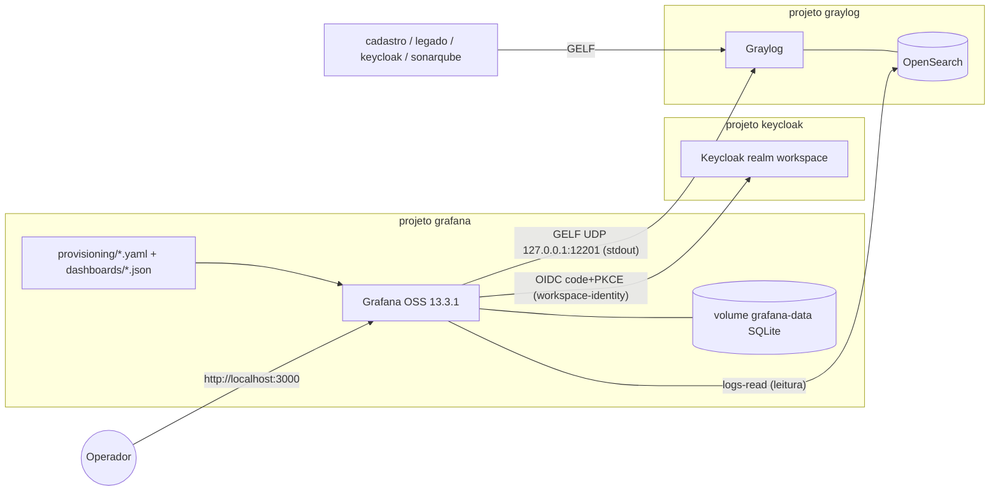

# Plano técnico 001 — Implantação do Grafana OSS

Spec: [spec.md](spec.md) · ADRs: [0001](../../adr/0001-stack-grafana-oss.md), [0002](../../adr/0002-sso-keycloak-grafana.md)

## 0. Levantamento do workspace (fatos verificados)

| Projeto | Fatos que importam ao Grafana |
|---|---|
| graylog | Graylog 7.2.2 + MongoDB + OpenSearch 3.7.0 (security plugin **desligado**, só na rede `graylog-internal`, ADR-0001). Rede compartilhada `observability`; GELF `graylog:12201` (TCP/UDP) e HTTP `12202`; host `127.0.0.1:9000/12201/12202`. `provision.sh` idempotente (inputs, index set, pipeline, streams, alertas) + `smoke-test.sh`. Mascaramento LGPD na gravação. |
| sonarqube | SonarQube 26.11 + Postgres 17 (porta host 9001; DB só em `sonarqube-internal`). Rede `quality`. Passcode `X-Sonar-Passcode` libera `/api/system/health` (e `/api/monitoring/metrics`). Molde: `generate-env.sh`, `provisioning/`, `scripts/`, `tests/`, `docker-compose.graylog.yml`. |
| keycloak | 26.8.2, realm `workspace`, `KC_HOSTNAME=http://localhost:8180` + `KC_HOSTNAME_BACKCHANNEL_DYNAMIC=true` (back-channel pelo nome `keycloak:8080` na rede `workspace-identity`). `KC_HEALTH_ENABLED` e `KC_METRICS_ENABLED` ligados (porta de gestão host 9100). Roles do realm: `admin` (OTP obrigatório), `user`, `log-investigator`. Clients: `cadastro` (provisionado por `provision.sh` `ensure_cadastro_client` + `realm-workspace.json`), `admin-cli`. PKCE S256 forçado por policy do realm. Direct Grant proibido. |
| cadastro | .NET 10 BFF + Angular/nginx (host 4300), **sem banco** (dados no Keycloak). Logs: Serilog -> GELF TCP `graylog:12201` via `observability` + stdout do nginx via driver GELF UDP (`docker-compose.graylog.yml`). Health `/health/live`, `/health/ready`, `/health`. **Sem OpenTelemetry** nos pacotes. |
| legado | .NET 10 API + Angular/nginx (host 4200) + SQL Server 2025 (host 1433). Mesmo padrão Serilog.Sinks.Graylog 3.1.1. **Sem OpenTelemetry**. Banco guarda dado pessoal. |
| Sites estáticos / WebAPI / cfo | Sem logs centralizados; fora do v1 (podem ganhar painel se enviarem logs). |

Portas em uso: 1433, 3000 (livre), 4200, 4300, 8025, 8180, 9000, 9001, 9100, 12201, 12202. Grafana -> **3000**.

Consequência-chave: **a única fonte rica e comum a todos os projetos é o Graylog/OpenSearch** (logs estruturados com
`service_name`, `level`, campos HTTP e `audit_event`). Métricas/traces OTel **não existem** nos apps hoje.

## 1. Versão e licença

- **Grafana OSS 13.3.1** (release de 2026-11-10, GitHub "Latest"; linha 12.4.15 como fallback). Imagem
  `grafana/grafana-oss:13.3.1@sha256:<digest>` (digest resolvido em T02). Atualizações: ler *What's new*/breaking changes
  e re-rodar o smoke.
- **Licença**: Grafana, Loki, Tempo e Mimir são **AGPLv3** (desde 2021). Uso interno, **sem modificar o código** do
  Grafana: não há obrigação de publicar fontes; a configuração/dashboards são nossos. Implicações: (a) não distribuir
  imagem modificada nem oferecer o Grafana modificado a terceiros pela rede sem liberar o código; (b) não usar
  recursos/plugins Enterprise; (c) plugins devem ter licença compatível (Art. IV.7) — `grafana-opensearch-datasource`
  é Apache-2.0 (**confirmar na T02**); (d) manter o aviso de licença na imagem. Registrado no ADR-0001.

## 2. Escopo de valor: mínimo (YAGNI) e incrementos

### v1 (recomendado) — Grafana + Graylog/OpenSearch, sem componente novo

| Item | Como | Componente novo? |
|---|---|---|
| Datasource de logs | plugin `grafana-opensearch-datasource` apontando para o OpenSearch do Graylog (índices dos index sets do Graylog), somente leitura por convenção | só o plugin (instalado no build da imagem) |
| Dashboards (5) | métricas derivadas dos logs: volume por nível, erros, 4xx/5xx, auditoria, eventos Keycloak, serviços sem log | não |
| Alertas | regras Grafana-managed sobre o mesmo datasource (poucas, não duplicar os alertas do Graylog) | não |
| SSO | Keycloak OIDC | client novo no realm |

Por que não o Graylog API como datasource: não há datasource oficial; um plugin genérico (Infinity) exigiria token e
perderia agregações temporais ricas. O OpenSearch já é o motor de busca do Graylog.

### Incrementos (decisão do usuário; **não entram na v1**)

| Opção | Ganho | Exige subir | Recomendação |
|---|---|---|---|
| **Prometheus** | métricas reais do Keycloak (`keycloak:9000/metrics`: logins, JVM, HTTP), SonarQube (`/api/monitoring/metrics` com passcode), Graylog (se exposto) e disponibilidade (up) | 1 container Prometheus (+ volume) | **Fase 2**, se o usuário quiser séries de métricas/uptime; barato |
| Datasources SQL (Legado/SQL Server, Postgres) | KPIs de negócio (cadastros/dia) | nada, mas expõe dado pessoal | **Não** agora (LGPD; exigiria read-only + views só com agregados em migration do legado) |
| OTel Collector + Tempo | traces ponta a ponta | Collector + Tempo **e instrumentar os apps** (pacotes OTel) | **Não** agora (esforço fora do Grafana; sem consumidor) |
| Loki | logs no Grafana | Loki + coletor | **Não**: duplicaria o Graylog (já decidido como casa dos logs, Constituição Art. VI) |
| Health/uptime dos .NET | `/health` JSON | Prometheus + blackbox exporter ou Infinity | Fase 2 junto do Prometheus |

## 3. Arquitetura



### Estrutura do projeto (molde graylog/sonarqube)

```
grafana/
  CLAUDE.md                     (a partir de _templates/project-CLAUDE.md; regras deste projeto)
  README.md
  docker-compose.yml            grafana (build do Dockerfile)
  docker-compose.graylog.yml    logging driver GELF (tag grafana) -> Graylog
  Dockerfile                    FROM grafana/grafana-oss:<tag>@<digest> + instala plugin versionado
  .env                          (gerado, fora do git)  .gitignore  .gitattributes
  provisioning/
    datasources/graylog-opensearch.yaml
    dashboards/providers.yaml           provider file, allowUiUpdates:false, uma pasta por projeto
    dashboards/<projeto>/*.json         cadastro, legado, keycloak, sonarqube, platform
    alerting/{rules,contact-points,policies}.yaml
  scripts/generate-env.sh  smoke-test.sh  backup.sh  restore.sh  lint-dashboards.sh
  tests/                        fixtures de logs sintéticos (GELF) + lint + e2e SSO (Playwright)
  docs/adr  docs/specs
```
Convenção do repositório: provisioning como **arquivos nativos do Grafana** (não precisa de container `provisioner`;
o Grafana lê no start). Segredos entram por **interpolação de variáveis de ambiente** `$__env{VAR}` nos YAML.

### Compose (descrição, sem código)
- Serviço `grafana`: build local; `127.0.0.1:3000:3000`; volume `grafana-data:/var/lib/grafana`; provisioning montado
  `:ro`; redes `observability`, `workspace-identity` (externas, nome fixo) e `logs-read`; `healthcheck`
  `GET /api/health` (database ok); `restart: unless-stopped`; env `GF_*` para toda a configuração (sem `grafana.ini` com segredo).
- Variáveis `${VAR:?defina VAR no .env}` como nos outros projetos.
- Rede `logs-read`: criada pelo **graylog** (T03; `name: logs-read`, o OpenSearch entra nela com alias `opensearch`)
  e declarada como externa aqui. Isola: só Grafana alcança o OpenSearch; apps em `observability` continuam sem acesso (ADR-0001).

## 4. Configuração do Grafana (via `GF_*`)

| Área | Configuração | Motivo |
|---|---|---|
| server | `root_url=http://localhost:3000`, bind 0.0.0.0 no container | callbacks OIDC |
| security | `admin_user` = nome não padrão, `admin_password` do `.env`, `secret_key` do `.env`, `disable_gravatar`, `cookie_samesite=lax`, `cookie_secure=false` local (true em HTTPS), `content_security_policy=true`, `x_content_type_options`, `x_xss_protection`, `allow_embedding=false` | hardening / ASVS |
| users | `allow_sign_up=false`, `auto_assign_org_role=None`, `viewers_can_edit=false`, `default_language=pt-BR` | negar por padrão |
| auth.anonymous | `enabled=false` | spec H2 |
| auth | `disable_login_form=false` (break-glass), `oauth_auto_login=false`, `signout_redirect_url` do Keycloak | recuperação |
| auth.generic_oauth | ver ADR-0002 | SSO |
| analytics | `reporting_enabled=false`, `check_for_updates=false`, `check_for_plugin_updates=false` | sem telemetria |
| log | `mode=console`, `console.format=json`, `level=info` | GELF/Graylog |
| unified_alerting | habilitado; `execute_alerts=true` | alertas |
| feature toggles | nenhum experimental | estabilidade |

> Chaves `GF_*` e opções acima são as documentadas; **a T02/T06 deve validá-las contra a doc da 13.3 (Context7)** — os nomes
> exatos de 13.x (ex.: possível CEL em `role_attribute_path`, visto na doc do Okta) devem ser confirmados antes de fixar.

## 5. SSO (resumo; detalhes no ADR-0002)

- Provider `generic_oauth` apontando para o realm `workspace`: `auth_url` pelo **host público** (`http://localhost:8180`,
  usado pelo navegador); `token_url`/`api_url` pelo back-channel `http://keycloak:8080` (suportado por
  `KC_HOSTNAME_BACKCHANNEL_DYNAMIC`, mesmo desenho do `cadastro`). `use_pkce=true`, `scopes=openid email profile roles`.
- Client `grafana` (confidencial, `standardFlowEnabled=true`, **`directAccessGrantsEnabled=false`, implícito off**,
  PKCE S256, redirect `http://localhost:3000/login/generic_oauth`, post-logout `http://localhost:3000/login`,
  `fullScopeAllowed=false` + mapper de **realm roles** para o claim `roles` no id_token/userinfo, só as roles `grafana-*` e `admin`).
- Mapeamento: `grafana-viewer`->Viewer, `grafana-editor`->Editor, `admin`->Admin; sem nenhuma -> negado
  (`role_attribute_strict=true`); `allow_assign_grafana_admin=false`; `skip_org_role_sync=false` (role sincroniza a cada login).
- Roles novas `grafana-viewer` e `grafana-editor` entram no `realm-workspace.json` e no `provision.sh` do **keycloak**
  (mesmo padrão de `ensure_cadastro_client`); `KC_GRAFANA_CLIENT_SECRET` gerado em `../keycloak/.env` e copiado ao
  `.env` do grafana pelo `generate-env.sh` (sem imprimir), como o Cadastro faz.
- Risco "usuário final do Cadastro no mesmo realm": coberto por `role_attribute_strict` + teste E2E negativo (T15).

## 6. Provisioning as code

- **Datasource** `graylog-opensearch` (uid fixo): `type: grafana-opensearch-datasource`, URL `http://opensearch:9200`,
  `version`/`flavor: opensearch` (conferir na T07), `timeField: timestamp`, `index` pelo padrão do(s) index set(s) do
  Graylog (conferir o prefixo real no `provision.sh`), `isDefault: true`, `editable: false`.
- **Pastas** (PT-BR): Cadastro, Legado, Keycloak, SonarQube, Graylog (Plataforma). Provider por pasta, `foldersFromFilesStructure: true`,
  `allowUiUpdates: false`, `disableDeletion: true`.
- **Dashboards** JSON clássico, `uid` estável kebab-case em inglês (`cadastro-overview`...), `schemaVersion` da 13.x,
  variáveis `service_name`/`environment`, links de drill-down. Produzidos na UI de dev, **exportados** e normalizados (sem `id`).
- **Alertas**: regras agrupadas por pasta, `for` e janelas explícitos, annotations com `dashboardUid`, política de notificação
  raiz + contact point conforme P4 (padrão: sem notificação externa, só estado na UI).
- Painéis só com agregações (RN-01). Contagem de eventos de auditoria por `audit_event`, nunca valor de campo pessoal.

### Dashboards iniciais (campos devem ser conferidos nos logs reais na T09-T12)

| Dashboard | Filtro | Painéis |
|---|---|---|
| Cadastro - Visão geral | `service_name` ∈ {cadastro-api, cadastro-web} | logs/min por nível; contagem Error/Warning; 4xx/5xx do nginx; top rotas com erro; eventos `audit_event`; saúde (ausência de logs) |
| Legado - Visão geral | `legado-api`, `legado-web` | idem + falhas de login (Warning), rate limit, chamadas à API interna de migração (sem login/senha) |
| Keycloak - Autenticação | `service_name:keycloak` | eventos por `type` (LOGIN, LOGIN_ERROR, `LEGACY_*`, `RESET_*`), falhas por hora, erros do servidor, fallback de auditoria |
| SonarQube - Infra | `sonarqube`, `sonarqube-db` | volume/erros, reinícios; (Quality Gate histórico fica para fase 2 via métricas/API) |
| Graylog - Plataforma | todos | ingestão por serviço, serviços sem log, descartes do pipeline, erros do próprio Grafana |

## 7. Observabilidade do Grafana

- Logs JSON em stdout -> driver GELF UDP `127.0.0.1:12201` (tag `grafana`), como `sonarqube`.
- **Mudança no graylog (T03)**: regra de pipeline `grafana-json.rule` (nível a partir do JSON, `service_name=grafana`),
  stream `Grafana - Infra`, retenção definida (LGPD; logs de login contêm e-mail de operador: confirmar mascaramento via
  `LGPD_LOGIN_FIELDS`/regra — **risco**: log de login do Grafana pode trazer `email`/`user`; mitigação: nível `warn` para
  o logger `context`/`auth` ou regra de descarte/máscara, com caso no smoke do graylog).
- Health: `GET /api/health` (healthcheck do compose e smoke). Métricas do próprio Grafana (`/metrics`) ficam desligadas até a fase 2.

## 8. Dados e backup

- Estado no volume `grafana-data` (SQLite: usuários SSO, preferências, silences, anotações). Tudo mais é regenerável do repo.
- `scripts/backup.sh`: `sqlite3 .backup` (ou parada breve) para `.backups/` (fora do git, `umask 077`); `restore.sh` em volume
  vazio; ambos testados no smoke. Sem migrations de schema próprias (gerido pelo Grafana); atualização de versão = backup antes.

## 9. Portão da Constituição

| Artigo | Status | Nota |
|---|---|---|
| I Idioma | ✅ | código/uids/nomes em inglês; comentários e docs PT-BR; títulos de UI PT-BR |
| II Simplicidade | ✅ | v1 sem componente novo; incrementos só sob demanda |
| III Arquitetura | ⚠️ | Clean Arch não se aplica (infra); banco próprio do Grafana (SQLite) sem compartilhar; Grafana lê o OpenSearch do Graylog (integração por dados, leitura) — registrado no ADR-0001 |
| IV Segurança | ✅ | Keycloak OIDC code+PKCE; segredos no `.env`; negar por padrão; sem PII; dependências pinadas. Ressalva: OpenSearch sem auth (herdado do graylog) -> mitigado pela rede `logs-read` |
| V Qualidade/testes | ✅ | smoke test, lint de dashboards, E2E SSO, restore; Sonar não aplicável (premissa 7) |
| VI Observabilidade | ✅ | logs ao Graylog, health `/api/health`; `/health/live|ready` não se aplica (não é app .NET) |
| VII Confiabilidade | ✅ | timeouts de datasource; alertas com `for`; sem mensageria |
| VIII Dados | ✅ | sem migrations próprias; backup/restore; datas UTC nas queries |
| IX Contratos | ✅ | consome contratos existentes; nova role/client no Keycloak é aditiva (sem quebra) |
| X Fluxo | ✅ | spec/plan/tasks; `DEV-001`; PT-BR |
| XI Conduta | ✅ | chaves `GF_*` e plugin a validar na doc antes de usar |

## 10. Perguntas ao usuário (recomendação padrão)

| # | Pergunta | Recomendação padrão |
|---|---|---|
| P1 | Fontes priorizadas? | v1: só Graylog/OpenSearch (logs) para os 5 projetos |
| P2 | Prometheus entra já? | Não na v1; Fase 2 (Keycloak + SonarQube + uptime) |
| P3 | Ambiente alvo? | Só local Docker agora; produção via nova spec (HTTPS, Postgres, OpenSearch com auth) |
| P4 | Canal de alertas? | Sem notificação externa na v1 (estado na UI); depois e-mail via Mailpit do keycloak (dev) ou o canal definido |
| P5 | Retenção/versão do Grafana? | Retenção = a do Graylog (30 d); Grafana 13.3.1 fixo |
| P6 | Viewer pode ver logs brutos? | Não; só Editor+ (Explore) |
| P7 | Licença AGPLv3 aceita? | Sim, uso interno sem modificar o código |
| P8 | Papel do `admin` do realm = Admin do Grafana? | Sim (já exige OTP) |

## 11. Riscos

| Risco | Prob./Impacto | Mitigação |
|---|---|---|
| OpenSearch sem autenticação acessível pelo Grafana (qualquer editor com Explore pode consultar) | M/M | rede `logs-read` dedicada; datasource read-only por convenção; produção: security plugin + usuário read-only |
| PII em logs/dashboards (LGPD) | B/A | agregações apenas; Viewer sem logs brutos; mascaramento do Graylog; teste `lint-dashboards.sh` proíbe painéis `logs` em pastas de Viewer e campos LGPD |
| Compatibilidade plugin OpenSearch x OpenSearch 3.7 x Grafana 13.3 | M/A | spike na T07 antes dos dashboards; fallback: datasource Elasticsearch nativo (flavor) ou Infinity sobre API do Graylog |
| Plugin baixado no build (rede/supply chain) | B/M | versão pinada, build em CI/local com verificação; sem `GF_INSTALL_PLUGINS` em runtime |
| Keycloak: `Parent flow doesn't exist` em provisionamentos concorrentes (já documentado) | M/B | não rodar T04/T15 junto de outros provisioners do keycloak |
| Rede `workspace-identity` externa inexistente | M/B | script reutiliza `../keycloak/scripts/identity-network.sh`; smoke detecta |
| Campos dos logs diferem do suposto (`type`, `audit_event`, `http_status`) | M/M | T09-T12 começam por fixtures GELF sintéticas e conferência nos logs reais |
| Mudança de breaking na 13.x (schema de dashboard, alerting) | B/M | exportar da própria 13.3; lint no smoke |
| Perda do volume | B/B | tudo regenerável do repo; backup do pouco estado |
| Executar smokes de infra concorrentes (graylog/keycloak) | M/B | documentar ordem no README |
